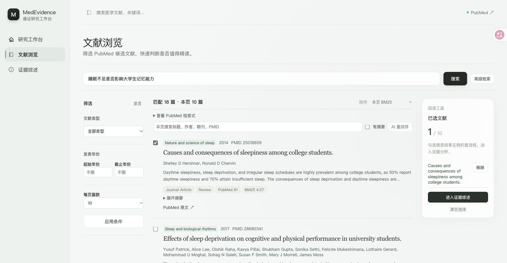

# MedEvidence V1.0

基于大语言模型的医学文献智能检索与证据综述系统。面向医学科研学习者，支持从研究问题出发检索真实 PubMed 文献、筛选候选、核对摘要并生成带 PMID 引用的 AI 综述。适用于医学人工智能导论课程展示和本地科研学习。



## 核心功能

| 功能 | 行为 |
| --- | --- |
| 文献检索 | 中文术语映射、同义词扩展、英文检索式可查看和修改。PubMed 提供真实文献、发表日期、类型、期刊、PMID、DOI 和摘要。 |
| 筛选与排序 | PubMed 按年份和类型过滤、服务端分页。可查看原始最佳匹配顺序，或使用本页 BM25、发表日期及主动触发的 AI 重排。 |
| 证据阅读 | 查看摘要与原文、跨页选择最多 10 篇，并可逐篇移除或清空。重新提交检索时建立新的选择范围。 |
| AI 证据综述 | 逐篇提取对象、目的、方法、发现、局限和模型解读，再生成带引用的一致性、分歧、局限和综合结论。支持多文献对比、定位到逐篇证据、查看摘要及导出 Markdown。 |
| 任务管理 | MySQL 保存研究问题、PMID、状态、创建时间和结果，支持轮询、重复提交复用、超时及失败。 |

## 本地运行

需要 Java 17、Maven 3.6.3+、Python 3 和可访问 PubMed 的网络。仅使用检索时可留空模型及数据库配置。

```bash
cp .env.example .env
# 编辑 .env，为 NCBI_EMAIL 填写实际联系邮箱。
set -a
source .env
set +a
mvn -f backend/pom.xml spring-boot:run
```

在另一终端启动静态前端：

```bash
python3 -m http.server 5173 --bind 127.0.0.1 --directory frontend
```

打开 http://localhost:5173。点击示例「睡眠不足是否影响大学生记忆能力」，提交检索，查看实际英文检索式。选择年份或文献类型后应用条件。配置 AI 后，可点击「AI 重排序」，或者勾选文章后点击「生成证据综述」。

### 工作台导航

- **研究空间**包含研究工作台、文献检索、我的文献库和检索历史。收藏与阅读清单独立；文献库最多保存 200 篇，可筛选、移除或整库导出。
- **智能分析**包含智能文献排序、证据对比、AI 证据综述和分析任务。切换页面复用内存中的当前检索、选择、重排与综述结果。分析任务列表可手动刷新状态或重新打开结果。
- **系统**提供模型配置状态、MySQL 连接与任务表读取检查，以及手动模型连接测试。模型测试会发起一次短请求。状态接口仅在本机可用，返回诊断结果，密钥与连接值由后端保管。

### 本机历史与导出

首页保留最近 8 次成功检索和最近 8 个分析任务。收藏、检索历史和任务入口记录使用当前浏览器的本地存储，换浏览器、换设备、换前端地址或清除站点数据后不会同步。任务正文和状态存放在配置的 MySQL，浏览器可用保存的任务 ID 重新查询；清空历史不会删除数据库任务。文献浏览页选择论文后，可将阅读清单导出为 Markdown 或 BibTeX；综述页面可单独导出带 PMID 引用的 Markdown。

## 配置

| 环境变量 | 说明 |
| --- | --- |
| `NCBI_EMAIL`、`NCBI_API_KEY` | NCBI 联系邮箱、可选的 API Key。单实例请求间隔至少 350 ms。 |
| `PUBMED_TIMEOUT` | 上游超时，默认 8 秒。 |
| `AI_BASE_URL`、`AI_MODEL`、`AI_API_KEY` | OpenAI 兼容服务，例如 `https://api.openai.com/v1`。模型须支持 Chat Completions JSON Object 模式及 temperature 参数。 |
| `AI_TIMEOUT`、`AI_RERANK_LIMIT` | 单次模型调用默认 25 秒。每次重排默认向模型提交 BM25 前 20 篇，可设为 1–50。 |
| `REVIEW_DB_URL`、`REVIEW_DB_USER`、`REVIEW_DB_PASSWORD` | MySQL JDBC 连接及业务账号。 |
| `FRONTEND_ORIGIN` | 前端 CORS origin，默认 `http://localhost:5173`。分开部署时同时调整前端 `search.js` 的 API origin。 |

模型会收到用户的研究问题和公开文献标题及摘要。请勿输入患者身份或其他敏感资料。实际密钥不得提交到仓库。

### 阿里云百炼

将工作空间对应的 OpenAI 兼容 Base URL、支持 JSON 对象输出的模型名称和 API Key 分别写入本地 `.env` 的 `AI_BASE_URL`、`AI_MODEL`、`AI_API_KEY`。例如北京通用端点为 `https://dashscope.aliyuncs.com/compatible-mode/v1`；也可使用控制台给出的专属端点。后端会附加 `/chat/completions`，并请求 `response_format.type=json_object`。地域、工作空间和模型权限以控制台为准。 [百炼 Chat 兼容接口](https://help.aliyun.com/zh/model-studio/qwen-api-via-openai-chat-completions)

Spring Boot 读取继承的环境变量。直接运行 Maven、JAR 或 IntelliJ IDEA 时，`.env` 不会自动加载。请按上面的终端启动步骤导出 `.env`，或在 IDEA 的本地运行配置中设置环境变量。代码仓库只提交空值模板 `.env.example`。

支持思考模式的千问模型可在本地设置 `AI_ENABLE_THINKING=false`，减少结构化抽取耗时。未设置时不发送此供应商参数。长摘要任务可将 `AI_TIMEOUT` 设为 `60s`。

供应商返回 `usage` 时，后端只记录输入、输出和总 Token 数；HTTP 错误只记录状态码。日志不记录密钥、请求头、请求正文或供应商原始响应。缺失的用量值保持未知。

遇到 HTTP 403 时，请保留错误码和 request_id。百炼 `AccessDenied.Unpurchased` 表示服务未开通：使用主账号或具备 `AliyunBailianFullAccess` 权限的 RAM 账号登录百炼控制台，完成实名认证并确认调用地域。通用 Key 与 Token Plan 专属 Key 必须匹配对应端点。程序会记录脱敏错误码和 request_id，不会自动切换账户或端点。 [百炼错误码说明](https://help.aliyun.com/zh/model-studio/error-code-start)

### 初始化 MySQL

使用 MySQL 8.x 或兼容实例。以管理员身份创建数据库，并设置应用账户。将密码示例替换为本地密码：

```sql
CREATE DATABASE IF NOT EXISTS medevidence CHARACTER SET utf8mb4;
CREATE USER 'medevidence'@'localhost' IDENTIFIED BY 'REPLACE_WITH_A_LOCAL_PASSWORD';
GRANT SELECT, INSERT, UPDATE ON medevidence.* TO 'medevidence'@'localhost';
```

首次初始化按顺序执行。基线版本已有表的用户只执行尚未执行的 002：

```bash
mysql -u root -p medevidence < database/001_review_tasks.sql
mysql -u root -p medevidence < database/002_review_inputs.sql
```

在 `.env` 填写 `REVIEW_DB_URL='jdbc:mysql://localhost:3306/medevidence'`、`REVIEW_DB_USER='medevidence'` 和 `REVIEW_DB_PASSWORD` 后重启后端。

## HTTP API

响应结构为 `{code, message, data}`，错误响应的 `data` 为 `null`。

```bash
curl -fsS http://localhost:8080/api/capabilities
curl -fsS http://localhost:8080/api/literature/search \
  -H 'Content-Type: application/json' \
  -d '{"query":"睡眠不足是否影响大学生记忆能力","page":1,"limit":10}'
curl -fsS http://localhost:8080/api/literature/search \
  -H 'Content-Type: application/json' \
  -d '{"query":"asthma AND inhaled corticosteroids","fromYear":2018,"toYear":2024,"publicationType":"rct","page":2,"limit":10}'
```

`englishQuery` 覆盖自动构造的检索式。单页可取 1–50 篇。文献类型支持 `rct`、`clinical`、`systematic`、`meta` 和 `review`。使用检索返回的英文检索式及真实 PMID 触发重排或综述：

```bash
curl -fsS http://localhost:8080/api/literature/rerank \
  -H 'Content-Type: application/json' \
  -d '{"question":"metformin and type 2 diabetes","englishQuery":"metformin AND type 2 diabetes","pmids":["32897388"]}'
curl -fsS http://localhost:8080/api/reviews \
  -H 'Content-Type: application/json' \
  -d '{"question":"二甲双胍对 2 型糖尿病患者的效果？","pmids":["32897388"]}'
curl -fsS "http://localhost:8080/api/reviews/${TASK_ID}"
```

`TASK_ID` 为提交时的 `data.id`。状态为 `PENDING`、`RUNNING`、`SUCCESS`、`FAILED` 或 `TIMED_OUT`。相同问题和 PMID 集合复用进行中或已成功任务。每次综述最多发起两次模型调用。任务超出 150 秒后在查询或提交时标记超时，重启前未完成的任务同样按截止时间处理。

## 项目结构与验证

- `backend/`：Java 17、Spring Boot 3.5 REST API。独立封装 PubMed、模型、BM25 与任务存储。
- `frontend/`：原生 HTML、CSS、JavaScript。独立静态部署，无构建依赖。
- `database/`：MySQL 初始化和迁移脚本。
- `docs/screenshots/`：浏览器中采集的真实工作台截图。

```bash
mvn -f backend/pom.xml verify
node --input-type=module --check < frontend/search.js
```

自动化测试使用本机模拟 PubMed 和模型返回，执行时需要绑定回环端口。前端沿用原生 JavaScript，无需打包，可用 `for file in frontend/*.js; do node --input-type=module --check < "$file" || exit; done` 检查全部模块。

### 验收边界

| 范围 | 验证方法 |
| --- | --- |
| PubMed 检索 | 用真实 PubMed 验证中文术语扩展、真实 PMID、分页、类型与年份筛选和 BM25。 |
| MySQL 与任务 | 在真实的隔离 MySQL 实例执行 001、002，验证状态、重复提交、失败记录、截止时间清理和应用重启后读取。 |
| 重排序、提取及综述链路 | 使用真实 PubMed 文献和可控的模拟模型响应验证接口、引用与任务流程。模拟结果仅测试程序行为。 |
| 真实模型 | 2026-11-18 使用百炼 `qwen3.8-flash` 验证连接、三篇文献重排、证据提取、综述、真实 MySQL 入库和重启后读取。使用 `AI_ENABLE_THINKING=false`、`AI_TIMEOUT=60s`。 |

核查时记录 PMID 和支持各字段的摘要原句，分别检查研究对象、研究设计、结果、局限和推断范围。摘要若未提供某项信息，应标为无法核实。观察性研究中的关联不可直接作为因果结论。页面与导出均将 AI 综述标记为待人工核查。

## 限制与使用范围

- PubMed ESearch 最多可翻阅前 10,000 篇。BM25 对标题加权，分数仅在当前候选页内可比较。BM25 和 AI 评分都用于排序，无法衡量概率、证据质量或消除漏召回。中文映射词表有限，请核对检索式。 [NCBI E-utilities 参数文档](https://www.ncbi.nlm.nih.gov/sites/books/NBK25499/)
- AI 内容基于摘要，长摘要的模型输入可能被截短。结果标记缺摘要来源，并校验 PMID 与原文引句。人工仍需检查陈述是否受引用支持，尤其是因果和证据强度。AI 结果未经人工专家审核，仅用于科研信息辅助，不用于个体诊断或治疗决策。
- 综述采用本机单用户模式，后端默认绑定回环地址，任务接口拒绝非回环请求。请勿通过公共反向代理转发这些任务接口。源码采用 MIT 许可证。自托管的 [Inter 字体](https://github.com/rsms/inter)和 [JetBrains Mono](https://github.com/JetBrains/JetBrainsMono) 使用 SIL Open Font License 1.1，许可文件位于 `frontend/assets/fonts/`。PubMed 摘要和文献内容遵循来源条款。 [NCBI 使用政策与摘要版权](https://www.ncbi.nlm.nih.gov/home/about/policies/)

### 2026-11-18 百炼真实调用记录

检索问题为“睡眠不足是否影响大学生记忆能力”。实际文献 PMID 为 25018659、28680341、36107513。重排与最终综述均通过服务端 PMID 校验；原文引句由后端提供候选片段，模型返回片段索引，后端保存对应的未改写原文。无效索引会被拒绝。旧版文本引句仍须通过逐字匹配校验。

排查过程中出现一次重排非法输出、两次综述超时和两次抽取校验失败，失败任务保存在数据库。最终成功综述任务在应用重启后读回一致。最终成功任务的提取用量为输入 2103、输出 521，综合用量为输入 642、输出 805，总计 4071 Token。整个排查中已返回用量的请求累计 15749 Token；超时请求未返回用量，未将其视为零消耗，实际计费以百炼账单为准。

人工对照发现，模型综合结论使用的“代偿性变化”并非原摘要明确报告的机制；“证据冲突”需要结合不同研究设计、终点和环境谨慎理解。因而本次通过的是接口、结构、引用关联和持久化流程验收，医学结论仍需人工逐条修订。
